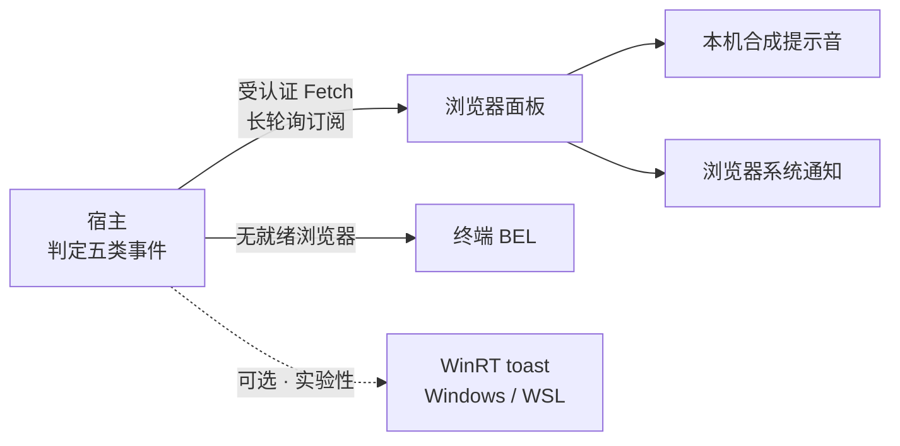

<h1 align="center">dsh-state-notifier</h1>

<p align="center">
  <a href="https://github.com/HOPE-LGNF/dsh-state-notifier/releases/latest"></a>
  <a href="LICENSE"></a>
  <a href="https://github.com/HOPE-LGNF/dsh-state-notifier/actions/workflows/check.yml"></a>
  
  
</p>

<p align="center">DeepSeek Harness 的通知插件：任务完成、等待审批、等待回答、任务受阻、任务出错，共五类提醒。</p>

<p align="center">
  <a href="#本地安装">安装</a> ·
  <a href="#启用浏览器提醒">启用</a> ·
  <a href="#配置">配置</a> ·
  <a href="#行为边界">边界</a> ·
  <a href="#开发">开发</a> ·
  <a href="docs/STATUS.md">项目状态</a>
</p>

回合结束或停下来等你时，用本机合成的提示音和系统通知把你叫回来。不需要下载声音素材，也不需要外部播放器。

设计上有两个目标：**准确判定事件**，**保持代码容易接手**。已验证到哪一步见[项目状态](docs/STATUS.md)。固定基线不保证支持以后的所有 `latest`。

## 功能

| 事件 | 触发条件 | 耗时门槛 |
| --- | --- | --- |
| 完成 | 回合正常结束，且有最终文本回答 | 受 `minDuration` 限制，默认 10 秒 |
| 审批 | 工具或命令在等待批准 | 不受限制 |
| 提问 | Agent 向你提问并等待回答 | 不受限制 |
| 受阻 | 任务被判定为受阻 | 不受限制 |
| 出错 | Agent 运行出错，含回合开始前的错误 | 不受限制 |

取消的回合、空回合、只调用工具的回合和子代理都不会误报完成。

其余能力：

- **四种合成音方案**。每个事件类别可选“默认、柔和、明亮、急促”，也可一键统一。
- **系统通知**。浏览器获准后发送，可出现在 Windows 通知中心；点击通知回到对应会话。
- **原生穿透通道**（实验性，默认关闭）。Windows 宿主（含 WSL）直接调用 WinRT toast，在专注助手与全屏下也能显示。
- **多标签协调**。两个同源标签页通过 Web Locks 和有界回执协调发送；设置改动立即生效并同步到其他同源标签页。
- **断线补发**。复用官方 Connection 的受认证 Fetch 路由长轮询订阅；同一宿主实例的断线可补发最近 256 条通知。
- **终端兜底**。没有就绪浏览器时，`auto` 使用终端 BEL；终端不能响铃时给出诊断，仍记录通知日志。
- **通知内容克制**。默认只显示分类、会话短标识与提问的问题正文，可在“通知外观”关闭。不会把任务正文、工具参数、审批理由或错误堆栈发给系统通知。

## 通知怎么到你这儿



宿主判定事件，浏览器负责出声和弹窗，终端始终保留日志。开启原生穿透后，系统通知改由宿主发出，浏览器只负责出声，避免同一条弹两次。

## 本地安装

### 兼容性

| 项目 | 范围 |
| --- | --- |
| Node.js | `^22.19.0` 或 `>=24.0.0`，建议 24 |
| dsh | `>=0.2.0-rc.2 <0.3.0-0`，本插件验证并允许的范围 |
| CI | Node 22 / 24 × Ubuntu / Windows 四组矩阵 |

装到范围外的 dsh 上会被插件管理器拒绝；需要时可逐版本豁免。

### 从源码构建

```bash
npm ci
npm run check
npm pack
```

### 安装到 web profile

以下命令使用固定的已测版本，并在仓库根目录执行（`$PWD` 指向该目录）：

```bash
npx @deepseek-ai/dsh@0.2.0-rc.2 plugin --profile web add "$PWD/dsh-state-notifier-0.5.0.tgz"
npx @deepseek-ai/dsh@0.2.0-rc.2 web
```

不在本仓库时，直接装 GitHub Release 附件。它自带浏览器产物，无需本地构建：

```bash
npx @deepseek-ai/dsh@0.2.0-rc.2 plugin --profile web add \
  "https://github.com/HOPE-LGNF/dsh-state-notifier/releases/download/v0.5.0/dsh-state-notifier-0.5.0.tgz"
```

> [!WARNING]
> **不要用 Git 地址安装**（插件界面的仓库 URL 或 `github:owner/repo`）。
> 浏览器产物 `dist/client.js` 不随 Git 分发：pnpm ≥10 默认阻止构建脚本，而放行所需的键包含提交号，每次更新都会变。
> 用 Git 地址时，安装要么被 `ERR_PNPM_GIT_DEP_PREPARE_NOT_ALLOWED` 拒绝，要么装上后因缺少该文件而启动失败。
> 请使用上面的 tgz 或 Release 附件。

## 启用浏览器提醒

1. 打开 dsh 页面。进入设置中的“常规”，或打开会话顶部的铃铛。
2. 勾选“播放声音”。首次需要点一次“点击解锁声音”，浏览器要求用户操作才能解锁音频。
3. 勾选“显示桌面通知”，并按提示点一次“点击授权桌面通知”，在浏览器提示中允许本站通知。
4. 展开“权限及运行信息”，查看声音、权限、连接与主机策略。

其余设置按需展开。“声音方案与试听”可选择并试听每类事件的合成音。“通知外观”可换铃铛图标、上传本机图标，选择通知里显示会话短标识还是会话标题，以及开关“显示提问的问题”。上传的图标只写入本机 `localStorage`，不会发送到宿主。

“显示提问的问题”默认开启。关闭后，提问正文不会随订阅响应发给浏览器，通知只保留分类与会话标识。

> [!NOTE]
> 声音授权与通知授权是两件事。刷新页面后可能需要再次解锁声音。通知权限若已被拒绝，请到浏览器站点设置中修改。

Windows 通知由 **Windows 上打开 dsh 页面的浏览器**发送，dsh 宿主可以运行在 WSL。远程 HTTP 地址通常不能使用系统通知，请使用 HTTPS；`localhost` 和回环地址通常是安全上下文。网页关闭、休眠或被浏览器冻结后，本插件不能保证提醒到达。它没有 Web Push 后台服务。

## 配置

全局策略只保存在 Cordis 配置中。可在 dsh 的插件设置里修改本插件的 Config，也可编辑 profile 的 `cordis.patch.yml`：

```yaml
- id: state-notifier
  config:
    enabled: true
    playback: auto
    minDuration: 10
    events:
      complete: true
      approval: true
      question: true
      block: true
      error: true
```

| 项目 | 含义 |
| --- | --- |
| `enabled` | 总开关；关闭后不产生新通知 |
| `playback` | 输出通道，取值见下表；默认 `auto` |
| `minDuration` | 完成通知的最短耗时，单位为秒；默认 10 |
| `events` | 五类通知的独立开关 |
| `native` | 穿透通道：`off` 关闭、`auto` 自动探测、`manual` 使用 `nativePath`；默认 `off` |
| `nativePath` | `manual` 模式下的解释器绝对路径，只接受 `powershell.exe` 或 `pwsh.exe` |

| `playback` 取值 | 行为 |
| --- | --- |
| `auto` | 有就绪浏览器时由浏览器输出，否则使用 BEL |
| `browser` | 只由浏览器输出 |
| `terminal` | 只用终端 BEL |
| `none` | 只记录日志 |

四种取值都保留终端日志。

浏览器面板的开关、音量、前台静音、每类声音方案、铃铛图标、会话显示方式与提问正文开关保存在该浏览器的 `localStorage` 中。它们不会覆盖全局策略。关闭此浏览器提醒后，`auto` 仍可能使用终端 BEL；需要全部静音时关闭宿主总开关。前台静音针对整个 dsh 窗口，不是“仅当前会话静音”。

## 更新与卸载

插件按 GitHub Release 附件分发，**版本号包含在 URL 里**。换版本时先卸载再安装：

```bash
npx @deepseek-ai/dsh@0.2.0-rc.2 plugin --profile web remove dsh-state-notifier
npx @deepseek-ai/dsh@0.2.0-rc.2 plugin --profile web add \
  "https://github.com/HOPE-LGNF/dsh-state-notifier/releases/download/v0.5.0/dsh-state-notifier-0.5.0.tgz"
```

直接对同一个旧 URL 重复 `add` 不会更新，因为 pnpm 认为该规格已满足。换版本必须让 URL 变，或先 `remove`。

升级 dsh 本体后先核对版本门。插件声明 `>=0.2.0-rc.2 <0.3.0-0`，超出范围会被拒绝安装；需要时用 `dsh plugin allow-version` 逐版本豁免。

### 升级不丢设置

- 浏览器偏好（音量、声音方案、图标、会话标题与提问正文开关）保存在本机 `localStorage`。
- 宿主配置（`native`、`nativePath`、`playback`、`minDuration`、事件开关）在 profile 配置里，升级不覆盖。
- 原生穿透模式在面板里切换是**运行时**生效，重启后回到 profile 配置值。要持久化，写入 profile 的 `cordis.patch.yml`：

```yaml
- id: state-notifier
  config:
    native: auto
```

### 卸载

```bash
npx @deepseek-ai/dsh@0.2.0-rc.2 plugin --profile web remove dsh-state-notifier
```

卸载后宿主不再注册通知路由；浏览器里残留的本机偏好不影响其他功能，可在站点数据中清除。

## 行为边界

### 投递保证

- 通知使用有界内存记录。宿主重启、插件重载或断线超过保留范围时，面板会提示记录重置。
- 首次打开页面只接收新通知，不补播旧任务。
- 已被禁用、前台静音或未授权的输出，不会在以后授权时集中重放。
- 发送回执表示浏览器接受了 API 调用，不表示用户已经看到或听到提醒。
- 浏览器崩溃、存储失败和操作系统免打扰仍可能造成重复或遗漏。没有 Web Locks 时，面板提示仅在一个标签页启用。
- **不能承诺严格恰好一次投递。**

### 权限与平台

- 原生穿透通道只做 Windows 与 WSL：Windows 宿主直接执行，WSL 宿主经 interop 调用。macOS 与 Linux 仍走浏览器通知。
- 首次启用时 Windows 可能询问是否允许此应用发送通知，请选择允许。若曾关闭，可在“设置 → 系统 → 通知”里重新打开；插件不会绕过这个决定。
- 面板里的“发送测试通知”会回报系统的通知许可状态（允许 / 被应用关闭 / 被用户关闭 / 被组策略禁用）。

### 与 bell、ding 的差异

本项目参考 bell 的五类事件和控制功能，重新实现了传输与播放。当前支持逐事件选择浏览器合成音，也支持终端 BEL。

未移植：bell 的 WAV 目录、逐事件 WAV 文件映射、WAV 播放器及中英文切换；ding 的声音上传、周期提醒和注册表协议。原生穿透通道只用 PowerShell 发送系统通知，不播放音频文件。

## 开发

依赖安装与构建命令见[本地安装](#本地安装)。`npm test` 使用 Node 内置测试框架，脚本自动选择当前 Node 支持的隔离参数。

检查宿主的新 Git 版本时，先记录提交，再运行 Session 检查：

```bash
git -C /path/to/deepseek-harness rev-parse HEAD
node scripts/check-upstream.mjs /path/to/deepseek-harness
```

把路径替换为本机宿主仓库。此脚本只替换 Session 实现，其他依赖来自本项目锁文件。还需核对[传输协议与插槽职责](docs/ARCHITECTURE.md#传输协议)，并按[浏览器检查方法](docs/VALIDATION-browser.md)运行完整应用。

需要离线导出时，在干净且已提交的工作树运行 `node scripts/export.mjs`。脚本生成 Git bundle 和 SHA-256 文件，并克隆恢复以比对 HEAD。

### 文档

- [架构](docs/ARCHITECTURE.md)：模块职责、协议与生命周期。
- [项目状态](docs/STATUS.md)：最新结果与待完成事项。
- [浏览器检查](docs/VALIDATION-browser.md)：夹具、完整 Web 与 Windows 操作。
- [开发约定](AGENTS.md)：修改、提交与发布要求。
- [变更记录](CHANGELOG.md)：版本变化。

## 致谢

- [deepseek-ai/deepseek-harness](https://github.com/deepseek-ai/deepseek-harness)：宿主、插件接口、官方文档与测试契约。
- [ZYar-er/dsh-notify-bell](https://github.com/ZYar-er/dsh-notify-bell)：五类通知、严格完成判定、终端响铃及铃铛入口的功能基准。
- [CAOGGL/dsh-ding](https://github.com/CAOGGL/dsh-ding)：Windows 系统通知、点击返回会话及静音体验的参考。
- [Cordis 论文](https://arxiv.org/abs/2608.25512)：可撤销副作用和响应式依赖的设计依据。
- [esbuild](https://github.com/evanw/esbuild)：把唯一一份浏览器源码构建为 dsh 客户端模块。

---

MIT License · [问题与建议](https://github.com/HOPE-LGNF/dsh-state-notifier/issues) · [变更记录](CHANGELOG.md)
